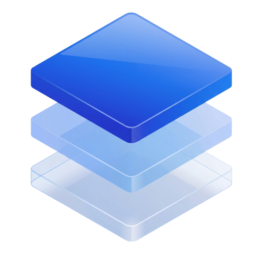

<p align="center">
  
</p>

# AuthRail Go SDK

AuthRail helps organisations control what connected AI agents may do and
understand what happened when they acted. In the workspace, you describe an
action, publish rules for it and review the decisions and completion reports.
Those rules are called **Rails**.

This SDK connects a Go function to those Rails. For example, you can wrap an
invoice reader so each agent request and returned invoice are checked by a
**sidecar**, a small service running beside your application. The application
keeps the business function and its provider credentials; the sidecar evaluates
the selected rules and sends decision records to AuthRail.

Start in **Observe** to see how the rules apply while the function continues
running. Switch to **Enforce** when the function should wait for permission;
the SDK also checks its result before returning it to the agent. A decision
explains permission, while a completion report describes what the application
says it did. When an operation affects an external provider, check that provider’s
record to establish its effect independently.

[Documentation](https://docs.authrail.io) ·
[Sidecar](https://github.com/AuthRail/authrail-sidecar) ·
[Node.js SDK](https://github.com/AuthRail/authrail-sdk-node) ·
[Go SDK](https://github.com/AuthRail/authrail-sdk-go) ·
[Python SDK](https://github.com/AuthRail/authrail-sdk-python)

## Choose a version

The install command below selects SDK **0.1.1**, which supports Observe and
Enforce, saved approval continuations, reconciliation, custom Guard handlers
and explicit fact readers. The [first-application guide](https://docs.authrail.io/docs/getting-started)
uses this release with a simple Policy Rail and a local invoice reader.

Some sections below also describe newer repository source. Automatic
Rail-owned Contextual AI, expanded built-in Guards and automatic Data reader
bindings are not part of SDK 0.1.1. Check
[compatibility](https://docs.authrail.io/docs/compatibility) before enabling those
requirements. The setup executable and native Runtime are version **0.2.0**,
while its Docker installer selects Runtime **0.1.0**; they have separate version
identities.

## Install and prepare

Prepare the AuthRail workspace before running an SDK check:

1. Create an AuthRail account if you need one, then sign in and open your
   organisation's workspace. You need access to manage its AI Inventory and
   Runtime configuration. The
   [first-application guide](https://docs.authrail.io/docs/getting-started) walks
   through these workspace steps.
2. Add or select the AI system in **AI Inventory** and confirm its identity.
   Create and review the action it will request, including its input and
   result fields. Copy its **Operation Version ID** for your code so the SDK refers to the
   input and result description you confirmed.
3. Publish the Rails for that action, then create an **Observe deployment**
   using the confirmed AI system and the published Rail versions. A deployment
   identifies the application setup whose decisions you want to track.
4. Run the [released sidecar's guided setup](https://docs.authrail.io/docs/native)
   with the API address supplied by your installation administrator. Choose
   Docker for a container application or native for a host application. Setup
   saves the keys, tokens and SDK helper files privately and registers only
   the public key with AuthRail.
5. Get the caller, session and target record from your application’s
   authentication and resource lookups, and keep the setup files private.

The SDK runs inside your Go program; the sidecar is a separate process.
Building the SDK or your program does not start the sidecar. The local URL
`http://127.0.0.1:7078` requires the application and sidecar to share a network
namespace. With Docker, follow the sidecar guide for that arrangement; an
unrelated container cannot reach the sidecar through its own loopback address. The **adapter
token** lets the SDK call the sidecar locally; the **deployment credential**
lets the sidecar connect to AuthRail. Keep these credentials, the application's
private signing key and provider credentials outside the agent.

Use Go 1.26 or newer. In your application's module directory, install the
[versioned module](https://pkg.go.dev/github.com/AuthRail/authrail-sdk-go):

```bash
go get github.com/AuthRail/authrail-sdk-go@v0.1.1
```

If you are starting a new application, first create its directory and run
`go mod init` with your application's module path. `go get` records the SDK in
`go.mod` and `go.sum`; it does not start a service. The
[v0.1.1 source tag](https://github.com/AuthRail/authrail-sdk-go/tree/v0.1.1)
identifies this version.

<details>
<summary>Build from source when contributing</summary>

```bash
git clone https://github.com/AuthRail/authrail-sdk-go.git
cd authrail-sdk-go
go build ./...
```

</details>

A successful build exits without starting a server. Start with
[Observe an action](#observe-an-action) in your own program; its code examples
use your existing business types and authenticated application context.
[Discover a deployment](#discover-a-deployment) is an optional onboarding path
through a short-lived setup key, rather than a substitute for the reviewed
configuration above. For Node.js, use the
[Node SDK](https://github.com/AuthRail/authrail-sdk-node) with the same sidecar.

## Observe an action

Use the `executor-private.pem` and `adapter-token` saved by guided setup.
Register only the public key; keep the private key with the protected application.
For existing operator-managed installations, reuse the registered key instead
of generating a replacement. Load the private key before creating the client:

```go
privateKeyPEM, err := os.ReadFile(os.Getenv("AUTHRAIL_EXECUTOR_PRIVATE_KEY_FILE"))
if err != nil { return err }
executorPrivateKey, err := authrail.ParseExecutorPrivateKeyPEM(privateKeyPEM)
if err != nil { return err }
```

Set up the client once in the protected application, then wrap the function you
already use:

```go
client, err := authrail.NewClient(authrail.Config{
    SidecarURL:   "http://127.0.0.1:7078",
    AdapterToken: os.Getenv("AUTHRAIL_ADAPTER_TOKEN"),
    OrganisationID: organisationID,
    DeploymentID: deploymentID,
    ExecutorPrivateKey: executorPrivateKey,
})
if err != nil { return err }

receipt, checks, err := authrail.Observe(ctx, client, authrail.Operation{
    VersionID: refundOperationVersionID,
    ActionKey: refund.ID,
    PrincipalID: currentStaff.ID,
    PrincipalSource: "application_session",
    SessionID: task.ID,
    ResourceID: refund.InvoiceID,
    ResourceSource: "application_lookup",
}, refund, func(ctx context.Context) (Receipt, error) {
    return payments.Refund(ctx, refund)
})
```

`receipt` and `err` are the function's own result and error. The function runs
once even if a Rail would deny it or the sidecar is unavailable. Read
`<-checks` when you want the call and result decisions or an observation error;
that check finishes separately and does not hold up the function's result.

For example, after handling the function's own error, inspect the checks:

```go
observation := <-checks
if observation.CallError != nil || observation.ResultError != nil {
    log.Printf("AuthRail check unavailable: call=%v result=%v",
        observation.CallError, observation.ResultError)
} else {
    log.Printf("AuthRail call=%s result=%s",
        observation.CallDecision.Outcome, observation.ResultDecision.Outcome)
}
```

Use Go's `log` package for this example. With a healthy Observe deployment,
you receive decisions for both phases; their outcomes depend on your published
Rails. `RecordingStatus == "retained"` means AuthRail stored the check;
`"queued"` means the sidecar saved it for later delivery. Open the deployment's
Runtime history in your workspace to inspect retained decisions. A failed
check needs investigation, but still does not stop an Observe callback.

The earlier snippet uses your application's `organisationID`, `deploymentID`,
`refundOperationVersionID`, `currentStaff`, `task`, `refund`, `Receipt` and
`payments` objects. Replace them with your own reviewed configuration and
business types. It is integration code for your program, not a standalone
server. The action contract must cover these fields and identities.

The Operation Version comes from the reviewed action in AuthRail. Give each
business action a stable `ActionKey` and reuse it on a retry. The SDK creates
the request ID and JSON for you. Supply opaque principal and task/session IDs;
use an opaque resource ID when the action targets one. AuthRail records these
as references supplied by your application, without independently verifying
the person or resource in Observe mode. `ExecutorPrivateKey` is an Ed25519
private key held by your protected application. Give its PEM public key to the
sidecar through `AUTHRAIL_EXECUTOR_PUBLIC_KEY_FILE`. The SDK signs each call and
result check for 30 seconds; the sidecar rejects a changed, expired, or missing
signature. Derive principal and resource IDs from your application's trusted
session and resource lookup before calling `Observe`. Set `PrincipalSource` to
`application_session` or `service_identity` based on that authentication. For an
Operation with a resource identity field, use the exact ID in the reviewed
argument and set `ResourceSource` to `application_lookup`. Otherwise leave
`ResourceID` empty and set `ResourceSource` to `not_applicable`. Missing or
mismatched claims make the local check unavailable, not an allow. These are
signed application claims, not independent AuthRail verification of a person
or record. Keep the signing key and adapter token in the protected application, where
the agent cannot read them. The sidecar uses its own separate deployment
credential to fetch Rails and report covered decisions to AuthRail. A decision's
`RecordingStatus` is `retained`, `queued`, or `unavailable`. A queued report is
saved by the sidecar for retry, but has no certificate yet. A retained response
includes its Action and certificate IDs.

Register the matching application public key on the deployment page before
sending signed reports. AuthRail verifies the signature against that registered
key when retaining a report, including one retried from the sidecar queue. A
signed assertion proves that the application key supplied the references; your
application still authenticates the person and resolves the resource.

## Enforce a protected action

Use a stable business `ActionKey` across process restarts. The callback must
use the supplied `ProviderIdempotencyKey` at the provider and retain the
`ExecutionContext` so it can query the provider after a timeout. An AuthRail
Action key alone does not deduplicate a provider effect.

```go
receipt, callDecision, resultDecision, err := authrail.Enforce(ctx, client,
    authrail.Operation{
        VersionID: paymentOperationVersionID,
        ActionKey: invoice.PaymentActionKey,
        PrincipalID: authenticatedStaff.ID,
        SessionID: task.ID,
        ResourceID: invoice.ID,
        PrincipalSource: "application_session",
        ResourceSource: "application_lookup",
    }, paymentRequest, func(ctx context.Context, checked PaymentRequest,
        execution authrail.ExecutionContext) (PaymentReceipt, error) {
        return payments.Pay(ctx, checked, execution.ProviderIdempotencyKey)
    })
```

`callDecision` is permission, not execution proof. A successful return means
the protected callback returned, AuthRail retained its signed success receipt,
and the result check allowed exposure. The receipt remains an authenticated
executor assertion, not independent provider proof.
A Policy can report `approval_required` again at the result hook. The Go adapter
releases that retained result only after a one-use permit was claimed for the
same Action. Denied, missing, replayed, or different-Action results remain
blocked after the provider callback.
The [executable HTTP handler example](examples/enforce-payment/main.go) uses a
mock provider ledger and one fixed test action key. Replace that key with a
distinct stable business key for each real effect, and derive the caller from
your authenticated application context.

On `ApprovalRequired`, keep the pending value while this process waits for a
named human decision, then call `ResumeApproval` with the original protected
operation. For a workflow crossing a request or process boundary, call
`pending.Continuation()` before claiming a permit. Encrypt and persist the
returned `ApprovalContinuation` in application-owned storage, scoped to the
authenticated user, organisation, deployment, Action and original business
request. It contains private arguments, facts and session context; do not send
it to an agent or accept a replacement supplied by an agent.

```go
var pending *authrail.ApprovalRequired
if errors.As(err, &pending) {
    continuation, snapshotErr := pending.Continuation()
    if snapshotErr != nil { return snapshotErr }
    // Encrypt and save json.Marshal(continuation) in your protected workflow store.
    // After the named reviewer approves, restore it and supply the original executor:
    // After restoring the continuation, ResumeApprovalFrom(ctx, client,
    // continuation, payInvoice) returns the result, result decision, and error.
}
```

After a restart, create a client using the same deployment identity and key,
restore the continuation and supply the original callback. Resumption keeps
the processed input and attempt ID; your application stores that state and
reconnects it to the worker that performs the work. Include an
`Operation.ReviewSummary` with the few facts the named reviewer needs, while
keeping secrets and raw payloads out of the summary.

If the permit claim response is lost, `RecoverApprovalFrom` uses the saved
continuation to read only an existing, unexpired permit for that exact Action,
input and executor. It never creates a second permit. An unavailable, expired,
mismatched or already-started permit does not run the callback. Do not blindly
retry a claim or effect. If a start receipt or provider outcome is uncertain,
inspect the Action and reconcile the provider outcome before considering any
new attempt.

On `OutcomeUnknownError`, inspect its `Recovery` value and query the provider
with the original idempotency key. Call `client.Reconcile` only after that
lookup establishes success or no effect. Until the provider outcome is established, leave it unknown and hold further
attempts. A fresh attempt requires a new signed call decision and
any newly required approval. The result hook reports a separate exposure
decision; it cannot roll back a provider operation.

For request correlation, set `Operation.Traceparent` from the protected
application's validated W3C trace context. It is telemetry only, not an
identity or authorization claim.

## Discover a deployment

An AI Inventory manager first creates a short-lived setup key for an integration
key, AI system name, and deployment name on the AI Inventory page. Keep the key
in the protected application, not in the agent. The integration key is a lookup
name, never authentication. An existing AI Inventory item can be linked from
its detail page instead of creating a second discovered item. Discover once
during setup:

```go
found, err := authrail.Discover(ctx, authrail.DiscoveryConfig{
    ControlPlaneURL: "https://authrail.example.com",
    SetupKey: os.Getenv("AUTHRAIL_SETUP_KEY"),
    AgentKey: "support-assistant",
})
if err != nil { return err }
```

The result has the AI Inventory item, revision, and deployment IDs plus its
confirmation status. Repeating discovery is safe, but an expired or revoked
key fails. Review and confirm the discovered AI system in AuthRail. Discovery
does not issue a deployment credential or allow an action; a tenant manager
sets up the separate sidecar credential and application signing key before
Observe reports. Keep the setup key out of sidecar configuration and never
give it to the agent.

Add AuthRail checks at the Go function that performs an AI-requested action.
Your application still runs the function. The SDK asks the nearby AuthRail
sidecar what the selected Rails would decide about the call and its result.

## Supply prior session reads

Some Guard rules need the application to process a field before it is used;
others check whether a required read happened earlier in the task. Both use
information supplied by the protected application, rather than a claim in
the agent’s conversation.

For a Guard that requires string processing, register `Config.GuardHandlers`
with its exact reviewed ID, SHA-256 version, kind (`sanitize` or `transform`),
and a side-effect-free `Process(context.Context, string) (string, error)`.
Enforce reads requirements from the authenticated local sidecar, processes only
the reviewed string fields, and signs before/after digests. Result processing
happens before exposure. Missing handlers, stale plans, conflicts, errors,
and unsupported isolation block the boundary. Each handler has four seconds
or the caller's earlier cancellation. A handler that ignores cancellation may
continue locally; it must never perform business effects. Approval resumes
reuse the processed call. Observe never runs processors. These assertions do
not independently verify handler code or sandbox containment.

To describe earlier reads, attach a `TrajectorySnapshot` to the Operation.
A trajectory is the relevant history of this authenticated task. Use the authenticated task's
`SessionID`, and include only exact Operation Version IDs whose **result hook
completed successfully** earlier in that task. Set `Complete: true` only when
the application can account for the full relevant history; otherwise omit the
snapshot or leave it incomplete. On the first checked call for a new task,
set `Start: true` with a complete empty list. Its result hook carries the same
start snapshot. Keep the same session ID on subsequent actions, with
`Start: false` and the full ordered list of unique earlier covered read
Operation Versions. The source read Operation must have call and
result coverage in the active signed bundle. Never build this list from
agent-supplied text.

```go
operation.Trajectory = &authrail.TrajectorySnapshot{
    SessionID: operation.SessionID,
    Start: true,
    Complete: true,
    PriorReadOperationVersionIDs: []string{},
}
```

The SDK copies the snapshot before starting asynchronous checks, so later
application changes cannot alter its signed contents. The sidecar compares
the ordered Operation Versions with its private history for the same caller
and session. Missing, changed or incomplete history leaves the check
unavailable. Because a read that bypassed the wrapper is invisible, this
comparison still depends on the application placing checks at each required
function.

`Values` can carry small session fields whose names and types are defined on
the Operation. Use those fields for application-established context, rather
than arbitrary conversation text or model output. A completed result check
can support read history, but does not establish that an earlier business
effect occurred; execution reports serve that separate purpose. Raw session
history and these values are not sent to AuthRail.

## Read a live fact in your protected application

A Data Rail can use facts read by the application before the protected action.
The source version defines which account, lookup and value it expects; the
sidecar also checks freshness. Choose the reader for that source and bind its
credentials in the protected application.

`LookupStripeInvoiceStatus` supports a normal Stripe account by default. It
first reads Stripe's current account with the application's credential and
requires its ID to match the reviewed account, then reads the invoice. Set
`ConnectedAccount: true` only for Stripe Connect: the account and invoice
requests then send the reviewed connected account ID in `Stripe-Account`. Both paths reject
redirects and a returned invoice with a different ID, and return `unavailable`
on timeout or provider failure. A mismatched account is `untrusted`. Never
give the Stripe credential to the agent.

`LookupQuickBooksInvoiceBalance` reads one invoice from the reviewed
QuickBooks Online realm with an application-owned OAuth access token. Set
`Sandbox: true` only for an Intuit test company; otherwise it uses the fixed
production host. The result contains `Invoice.Balance` for the Data Rail. A different invoice ID or invalid balance is `untrusted`;
provider failure or a redirect is `unavailable`. Supply the exact realm,
invoice ID, timeout, and Context Source Version from the reviewed contract,
never from the agent. The application owns token acquisition and refresh; the
SDK does not store a refresh token or create a QuickBooks connection.
`Balance` is in the invoice's currency; this source contract does not pin a
currency, so a numeric threshold must not be presented as currency-qualified
without another reviewed source.

The protected application owns QuickBooks consent and its OAuth callback.
Bind the returned realm ID to the reviewed account before storing tokens in
its own encrypted, access-controlled credential store. Refresh before a read
when needed, serialize refresh per realm, and persist the newest access and
refresh tokens together before using them. Expired, revoked, or mismatched
grants produce unavailable context and require reconnection. Keep tokens,
OAuth codes, and provider response bodies away from the agent, sidecar, and
AuthRail. Stripe keys also stay in that store, scoped to the reviewed account.
Your application supplies an access token for the read. It remains responsible
for consent, token storage and refresh, while the SDK performs the lookup.

`LookupCustomerFact` calls your named, read-only lookup with a bounded context.
Your callback should honour cancellation and keep its database or API
credential private. Return the source, lookup, account or tenant, and the time
the value was observed. The helper checks that these match the configured
source, and preserves the observation time so a cached value is not presented
as newly read. Both helpers return the
source version, lookup key, account, observation time, and bounded value for
the local decision protocol. Configure them from the **exact reviewed Context
Source Version**, not a copied endpoint or an agent-provided account ID.

For example, read a Stripe invoice before the protected action and attach the
resolution to that action's `Operation`:

```go
fact, err := authrail.LookupStripeInvoiceStatus(ctx, authrail.StripeInvoiceSource{
    SourceVersionID: reviewedSourceVersionID,
    ProviderAccountID: reviewedStripeAccountID,
    Timeout: time.Duration(reviewedTimeoutMs) * time.Millisecond,
    SecretKey: stripeSecretHeldByApplication,
}, refund.InvoiceID)
if err != nil { return err }
operation.FactResolutions = []authrail.FactResolution{fact}
```

The action arguments must contain the invoice ID in the exact field reviewed
for that source. A provider outage returns an `unavailable` fact, not a guessed
status. A configuration error is returned separately and must be handled by the
protected application.

For a customer API, `NewCustomerAPIReader` supplies a concrete HTTPS read-only
callback. Configure its fixed collection endpoint and bearer credential in the
protected application. It performs one `GET` for the record key, does not follow
redirects, and accepts only a bounded JSON response shaped as
`{"accountId":"tenant_123","recordId":"invoice_123","observedAt":"...","data":{...}}`.
`LookupCustomerFact` compares the returned account, record key, source name,
and lookup with the reviewed source before the sidecar checks the projected
fact and its freshness. Other customer-owned sources can implement the same
`CustomerRead` callback contract without placing credentials in AuthRail.

Pass the returned resolution in `Operation.FactResolutions` when calling
`Observe`. The SDK signs it together with the action input. The sidecar checks
the exact published Data Rail's source version, account, lookup, record key,
value type, and freshness before a Policy Rail may read the fact. Missing,
stale, mismatched, and unavailable facts cannot satisfy the rule. AuthRail
retains only the reported fact status and source/lookup provenance in the
Observe certificate, not the fact value or record key. A successful read is
context, not authorization of the requested business action, and Observe still
does not stop the action.

## Use AuthRail Contextual AI

The integration in this section is available in current source, but not in
published SDK 0.1.1. Choose a compatible released SDK and Runtime before using
it in an installed application.

Some rules need to understand meaning as well as compare values. For example,
a release rule might ask whether a code change weakens authentication. Enable
**AuthRail Contextual AI** on the Guard or Policy Rail, describe the rule and
review the question, permitted fields and answer that AuthRail prepares. Test
those choices before publishing the Rail.

During a call or result check, the SDK obtains that assessment from the sidecar,
applies any required local processing and selects the permitted material. It
sends that material through the sidecar to AuthRail for interpretation. AuthRail
returns a signed finding, which the sidecar verifies against the request,
caller, material and Rail version before using it in the rule. AuthRail operates
the interpretation service, so your application does not need model credentials,
a prompt or a separately configured extractor.

If Contextual AI is off for the Rail, it sends no contextual request. If the
assessment is uncertain, material is missing or the service is unavailable, the
rule cannot pass using an invented answer. Ordinary authentication, data lookups
and human approval still apply; interpretation supplies information to a rule,
not permission to perform the action.

Review disclosure before publication because AuthRail receives the selected
material for transient processing. Normal Actions, logs and traces exclude that
material and retain the assessment status and finding instead. The
[Contextual AI guide](https://docs.authrail.io/docs/facts) explains this flow
and its failure handling.

### Observe execution outcomes

`Observation.Call` contains the frozen original attempt after the advisory
checks complete. Pass it to `client.ReportObservedExecution(ctx, *checks.Call,
outcome)` with an `ObservedExecutionOutcome`: `Event`, the executor's stable
`ProviderIdempotencyKey`, and optional `ProviderReference`. Supported events
are `succeeded`, `failed`, `unknown`, `reconciled_succeeded`, and
`reconciled_failed`. A tool error normally needs `unknown` until the executor
can establish whether its effect happened. Never infer success from an allow
decision, and never rerun an operation to retry its receipt.

`RecordingStatus` distinguishes local durable `queued` delivery from central
`retained` evidence. A retained response supplies Action and receipt IDs.
Reporting is separate from execution and does not request a permit or change
Observe's advisory decision. Keep the original call until report delivery is
acknowledged; send only bounded references and exact input digests.

## Validate the SDK source combination

Run `go test -race ./...` for the Go SDK checks. With `authrail-sidecar` and
`authrail-sdk-node` checked out beside this repository, Node dependencies
installed, and Go module dependencies available, run:

```sh
sh scripts/check-sidecar.sh
```

This builds the Node SDK and connects both SDKs to the real sidecar HTTP
handlers. The harness generates private temporary credentials and a signed
Enforce bundle; it checks allowed call/result hooks, denied calls without an
effect, JSON-persisted approval recovery and duplicate-start blocking. The
fixture verifies the signed permit and receipt statements. It uses isolated
loopback listeners and temporary state, then removes them. It never reads
customer secrets, changes a running sidecar, calls a provider or uses tenant
records.

The control plane in this check is a fixture, so `retained` responses establish
SDK/sidecar protocol translation only. Central persistence, human review,
provider reconciliation, full interception, Docker recovery and release
compatibility require their own connected verification. String Guard handlers
do not establish isolation; source-read and extraction provenance remain
protected-application assertions. Neither SDK automatically restores callbacks,
persists application workflow state or retries a business effect.

## Continuous integration

SDK CI runs on pull requests and pushes to main and the existing feature branch.
It checks Go formatting, `go vet`, and tests with the race detector. It also
compiles an independent consumer against the committed source archive; run
`sh scripts/check-package.sh` to check that locally. This checks packaging before
each version is published; installation through the Go module proxy is checked at release.

A separate job checks this candidate with pinned Node SDK and sidecar commits,
using the actual sidecar handlers and disposable local state. Its signed
control-plane fixture does not prove tenant persistence or provider effects.
It needs no deployment secrets. CI does not create release tags.

Maintainers: see [Releasing](RELEASING.md) for checked artifacts and publication setup.
